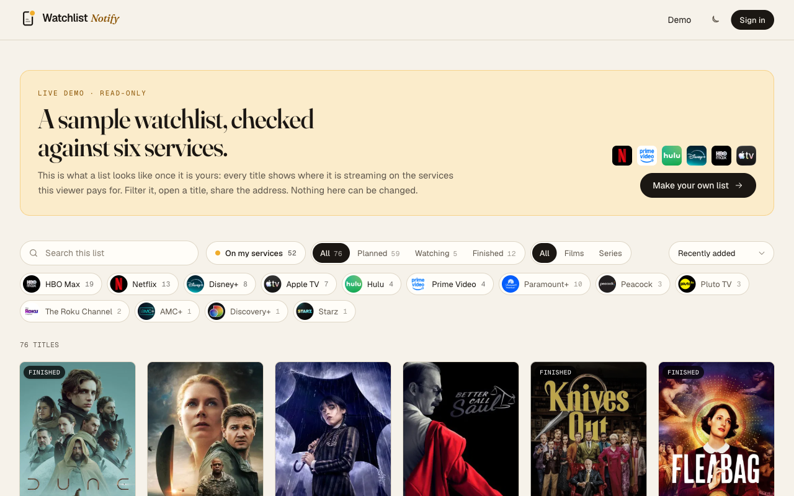
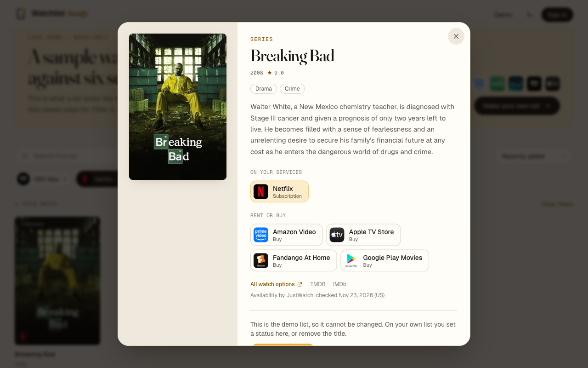
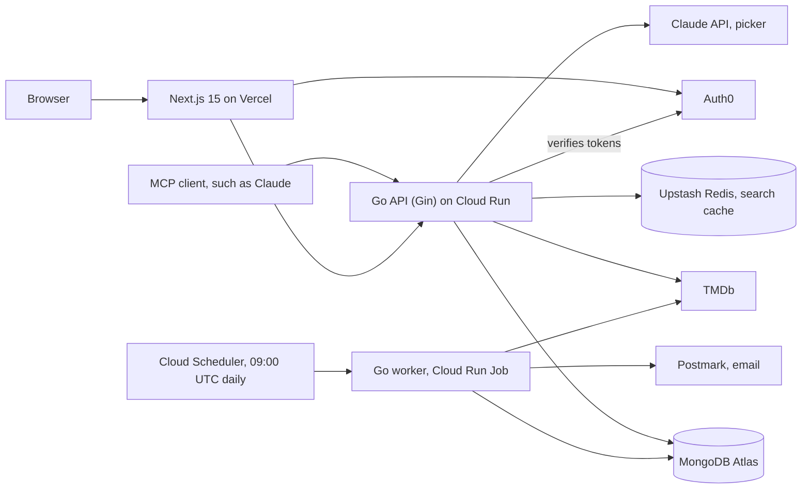

# Watchlist Notify

A watchlist of films and series that is checked every day against the streaming services you pay for, with a Go API and worker behind a Next.js frontend.

- Live site: https://watchlistnotify.com
- Public demo, no account needed: https://watchlistnotify.com/demo
- API docs: [docs/API.md](docs/API.md). The API serves Swagger UI at `/swagger/index.html`.
- MCP server docs: [docs/MCP.md](docs/MCP.md)





## What it does

- Keeps a watchlist of films and series, each with a status (planned, watching, finished) and tags.
- Checks every title once a day against the streaming services you have. Availability comes from TMDb, which gets it from JustWatch.
- Sends an email digest of titles that newly arrived on your services.
- Imports from IMDb: a CSV export, or a public IMDb list you link, which is synced once a day.
- Runs an MCP server at `/mcp`, so an AI client such as Claude can read and edit your list after you sign in.
- Offers a "What should I watch tonight?" picker that asks Claude to choose from your list. It is off unless an Anthropic API key (`ANTHROPIC_API_KEY`) is configured, and its panel is hidden when it is off.

## Architecture



The frontend's pages are rendered on the server and call the API from there with the signed-in user's Auth0 access token. The API is a Go (Gin) service on Cloud Run. The worker is a separate binary run as a Cloud Run Job, triggered once a day at 09:00 UTC by Cloud Scheduler. In one run it refreshes streaming availability, syncs linked IMDb lists and sends the digest. Data lives in MongoDB Atlas. Redis caches TMDb search results only, and the API runs without it (`REDIS_URL=disabled`).

## Engineering notes

**Availability is stored, not fetched per page view.** The worker refreshes a `titles` collection once a day, recording what changed. The API serves the watchlist from it with one query, instead of asking TMDb about every title on every request. This is where the numbers under [Results](#results) come from.

**The IMDb sync deletes user data, so it is conservative.** It is built so that a bad fetch or a race cannot remove titles by accident. Each write is a conditional update whose filter carries the safety condition, so a stale read cannot slip past it. A title is removed only after it was missing from two complete fetches at least 12 hours apart, and only if the sync added or adopted it, its status is still "planned" and it has no tags. A time-boxed lease stops the worker and a concurrent link or unlink request from acting on stale reads: the API refuses to change the link for 60 seconds after a run claims it, and the run may delete for only 45. See [internal/imdbsync](internal/imdbsync) and [watchlist_sync_repo.go](internal/database/watchlist_sync_repo.go).

**The MCP server is an OAuth 2.1 protected resource.** It speaks stateless Streamable HTTP and publishes RFC 9728 protected resource metadata, so a client can discover where to sign in. Tokens are bound to the MCP audience. The REST API and MCP use the same signing key, so the audience is checked in both directions: a token for one is refused by the other. A token must carry a verified email, and each tool needs its own scope (`watchlist:read` or `watchlist:write`). See [internal/middleware/mcp.go](internal/middleware/mcp.go) and [internal/server/mcp.go](internal/server/mcp.go).

**The AI picker is bounded.** The server builds a candidate list from the user's own titles that are streaming on their services, and the model sees them under small indexes. It answers with indexes, which the server validates against that list. Anything else it says is reduced to a short line of display text. Two per-day caps, one per user and one across all users, are reserved with an atomic check-and-increment in MongoDB before any paid call is made. A call that fails still counts against them.

**The digest sender can be told not to send.** `DIGEST_MODE` defaults to `dry-run`, which logs what would be sent and writes nothing. In `send` mode an email goes out only if the account's address is in `DIGEST_ALLOWLIST`. An empty allowlist emails no one.

**Testing.** There are table-driven unit tests, and handler tests that run against an in-memory store fake ([internal/storetest](internal/storetest)). The MongoDB repository tests run against a real MongoDB in a container started with testcontainers. GitHub Actions runs the Go checks and the frontend checks on every pull request.

## Results

Measured on the live site, signed in to a real account with about 240 titles and 11 services.

| | Before the rework | After |
|---|---|---|
| Home page, first visit | about 12 s (8.2 s of it one availability request) | 0.5 s to largest content |
| Home page, repeat visit | 1.5 s | 0.5 s |
| Watchlist page | 2.0 to 3.6 s, 239 backend calls | 0.6 s, one backend call |
| API time to list a 239-title watchlist with availability | 8.2 s | 0.19 s (median of 14 requests) |
| Search | 0.2 s | 0.17 s |

The API's cold start on Cloud Run measured 1.65 s for `/health`, against 0.16 to 0.18 s warm. The full list used to be one 395 KB response. It is now paged and gzip-compressed.

## Run it locally

You need Go 1.25 or later, Docker (for a local MongoDB), and Node 22 with pnpm for the frontend. A TMDb API key and an Auth0 tenant are needed to run the API end to end.

```bash
# API: copy .example.env to .env and fill it in, then
make docker-run     # MongoDB, from docker-compose.yml
make run            # the API on PORT

# Worker: one run of refresh, imdb sync and digest (the digest is a dry run)
make worker
make worker-refresh        # availability refresh only
make worker-imdb-dry-run   # IMDb sync that logs and writes nothing

# Frontend: copy frontend/.env.example to frontend/.env.local, then
cd frontend
pnpm install
pnpm dev            # http://localhost:3000
```

The frontend can also run with no backend and no Auth0, against a mock API:

```bash
cd frontend
node scripts/mock-api.mjs                   # a fake API on port 8787
BACKEND_URL=http://localhost:8787 pnpm dev  # in another terminal
```

[frontend/README.md](frontend/README.md) covers the signed-in mock session and the mock's switches. [cmd/worker/README.md](cmd/worker/README.md) documents the worker's tasks and settings, and [cloudrun.env.example](cloudrun.env.example) lists the production environment variables.

## Tests and CI

```bash
go test ./...                         # or: make test

cd frontend
pnpm lint
pnpm typecheck
pnpm build
```

The tests in `internal/database` start MongoDB in a container, so they need Docker running. Without it that package fails (`make itest` runs just that package). CI ([.github/workflows/ci.yml](.github/workflows/ci.yml)) runs `gofmt`, `go vet`, `go build` and `go test ./... -race -count=1` for Go, and `pnpm lint`, `pnpm typecheck` and `pnpm build` for the frontend.

## Deployment

The API image is built and deployed to Cloud Run with [scripts/release.sh](scripts/release.sh), and the worker image and its Cloud Run Job with [scripts/release-worker.sh](scripts/release-worker.sh). Either script builds locally with buildx or, with `--cloud-build`, in Cloud Build. The Cloud Scheduler trigger is created once, with the command in [cmd/worker/README.md](cmd/worker/README.md#schedule). Vercel deploys the frontend from `main`.

## Notes and limits

- Availability is for the user's region and is as fresh as the daily refresh.
- IMDb has no public API. The sync reads a public list that the user links, and IMDb's terms restrict automated use. For that reason it is opt-in, reads a list when it is linked and then once a day, and stores only title IDs.
- The "What should I watch tonight?" picker needs an Anthropic API key and is subject to the daily caps described above.

## Credits and licence

This product uses the TMDB API but is not endorsed or certified by TMDB. Streaming availability is from JustWatch, through TMDb.

Licensed under the MIT License, see [LICENCE](LICENCE). Built by Neil Mahajan.
